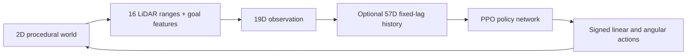

# Mapless Robot Navigation with PPO

**Goal-directed obstacle avoidance from sparse simulated LiDAR and relative goal observations.**

A compact, reproducible **2D robotics simulation** built with Gymnasium and Stable-Baselines3. The project includes a trained PPO checkpoint, an interactive Pygame viewer, procedural navigation scenes, a classical potential-field baseline, and tools for reproducible evaluation, stress testing and ablations.


## System overview

| Component | Design |
|---|---|
| Observations | Goal distance, sine/cosine of goal bearing, 16 simulated 360° LiDAR measurements (19 values) |
| History | Three observations at t−20, t−10 and t (57 values) |
| Policy | PPO actor–critic MLP, two 64×64 hidden layers per network |
| Actions | Signed forward/backward velocity and yaw rate |
| Environment | Deterministic 2D kinematics at 30 Hz, circular static obstacles, procedural scenes |
| Evaluation | Fixed-seed episodes, per-episode CSV/JSON, Wilson confidence intervals, failure traces |
| Baselines | Original untuned field and a redesigned, validation-tunable field |

## Reference PPO results

The included `models/navigation_ppo.zip` is a **frozen checkpoint**. Its recorded results on the original procedural `hard` scene family were:

| Obstacles | Goals reached | Collisions | Timeouts |
|---:|---:|---:|---:|
| 2 | 448/500 (89.6%) | 5 | 47 |
| 3 | 471/500 (94.2%) | 18 | 11 |
| 4 | 461/500 (92.2%) | 30 | 9 |
| 5 | 437/500 (87.4%) | 58 | 5 |

These are **simulation-only, in-distribution** results. Notably, the five-obstacle experiment includes an 11.6% collision rate; the two-obstacle experiment contains 47 timeouts. The generator frequently positions obstacles near the start–goal segment, and separate obstacle counts are not identical scene distributions.

An initial, exploratory PPO comparison used an **untuned, forward-only potential-field controller**. Its 7.45% aggregate goal-reaching rate was accompanied by 92.55% timeouts. That result is **not** evidence that PPO outperforms a well-tuned classical planner. The historical figures are retained in [`results/`](results/), clearly separated from the revised field and its not-yet-run validation. See [data provenance](docs/DATA_PROVENANCE.md).

## Install and run

Python 3.11+ is required. From the project root:

```bash
python -m pip install -e ".[test]"
python -m pytest
python run.py view best hard 5
```

The shipped model is in `models/navigation_ppo.zip`. **Do not extract it.** Viewer controls: `N` next episode, `R` replay, `SPACE` pause, `L` LiDAR, `S` screenshot, `ESC` close.

Evaluate the reference checkpoint, writing actual per-episode data:

```bash
python run.py eval best hard 2-5 --episodes 500 --csv results/ppo_eval.csv --json results/ppo_eval.json
```

## Classical baseline: tune first, test second

`potential_legacy` reproduces the original untuned controller. The revised `potential` uses **capped obstacle repulsion, tangential bypass and optional reverse motion**. Its default gains are illustrative; the program labels them *untuned* unless passed a validated configuration.

```bash
# Select gains exclusively on a separate validation seed interval.
python run.py tune-baseline --difficulty hard --obstacles 2-5 --seed-start 30000 --episodes 30 --output configs/potential_validated.json

# Compare both controllers on held-out scenes using the selected gains.
python run.py benchmark --controllers both --baseline-config configs/potential_validated.json --difficulty hard --obstacles 2-5 --episodes 500 --seed-start 60000 --csv results/paired_benchmark.csv --json results/paired_benchmark.json

# Verify that individual CSV outcomes match the JSON summary.
python scripts/check_episode_artifacts.py results/paired_benchmark.csv results/paired_benchmark.json

# Reproduce the historical (untuned) baseline, explicitly distinguished.
python run.py benchmark --controllers both_legacy --difficulty hard --obstacles 2-5 --episodes 500
```

No post-calibration test results have been added to the repository yet; comparison claims must await a fresh completed run.

## Stress testing, ablations and timeout analysis

`eval` and `benchmark` share an episode runner and support **19D or 57D** policies, sensor noise and new obstacle layouts:

```bash
# Alternative obstacle placement, without the default forced midpoint obstacle.
python run.py eval best hard 5 --layout uniform --episodes 500 --csv results/ood_uniform.csv

# Goal distance 3.5–5.0 m and changed obstacle sampling.
python run.py eval best hard 5 --layout long_goal --episodes 500 --csv results/ood_long_goal.csv

# Gaussian LiDAR range noise (meters), plus dropout.
python run.py eval best hard 5 --lidar-noise 0.05 --dropout 0.05 --episodes 500 --csv results/ood_noise.csv

# A separately trained 19D policy can use the same benchmark and stress tools.
python run.py benchmark --controllers ppo --model models/ablation_no_history_seed42.zip --history single --layout uniform --difficulty hard --obstacles 2-5 --episodes 500

# Capture and summarize the 2-obstacle failure distribution.
python run.py benchmark --controllers ppo --difficulty hard --obstacles 2 --episodes 500 --csv results/two_obstacles.csv --trace-csv results/timeout_traces.csv --trace-timeouts 10
python scripts/timeout_summary.py results/two_obstacles.csv --obstacles 2
```

The commands above are **experimental protocols**, not already-measured out-of-distribution results.

For independent training ablations (full, no history, no risk term) with three random seeds each:

```bash
python scripts/run_ablations.py            # Preview all nine jobs.
python scripts/run_ablations.py --execute  # Explicitly train and evaluate.
```

New training can select checkpoints on fixed **multi-obstacle validation seeds** (50 episodes per obstacle count by default), not a noisy single 10-episode five-obstacle sample:

```bash
python run.py train scratch mixed 2-5 200000 models/new_policy --eval-every 10000 --validation-episodes 50 --tensorboard-log runs
```

Optional `--observation-scale fixed` scales metric distances for **newly trained models only**. The released policy requires **raw 57-dimensional observations**. Incompatible preprocessing is rejected using the released model identity and training sidecar metadata.

## Architecture and limitations



The robot is approximated as a disk with ideal planar kinematics; obstacles are static circles. The environment has no walls, moving obstacles, 3D sensing, actuator delay, odometry drift, localization error or collision-prevention system. It is **not a validated real-robot controller**. The original reward uses post-update heading for its collision-risk component; this convention and unnormalized observations are preserved for checkpoint compatibility.

The checkpoint stores 190,464 cumulative steps, but not the complete staged-training history or original TensorBoard logs. New scratch experiments are not claimed to reproduce that historical path.

**Documentation:** [Technical brief](docs/PROJECT_BRIEF.md) · [Experiments](docs/EXPERIMENTS.md) · [Model card](docs/MODEL_CARD.md) · [Baseline methodology](docs/BASELINES_AND_ROBUSTNESS.md) · [Ablations](docs/ABLATIONS.md) · [Data provenance](docs/DATA_PROVENANCE.md) · [Changelog](CHANGELOG.md).

**Related research:** [Khatib (1986)](https://doi.org/10.1177/027836498600500106) · [Tai et al. (2017)](https://doi.org/10.1109/IROS.2017.8202134) · [Schulman et al. (2017)](https://arxiv.org/abs/1707.06347).

**Stack:** Python · PyTorch · Stable-Baselines3 · Gymnasium · NumPy · Pygame. **License:** [MIT](LICENSE).