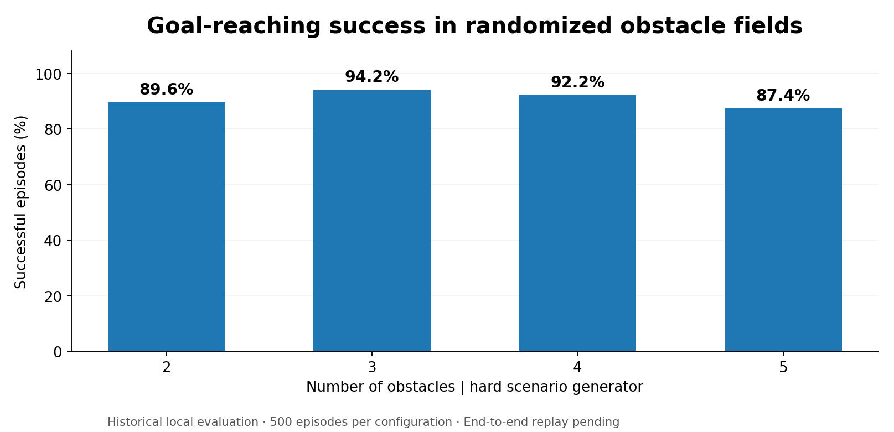
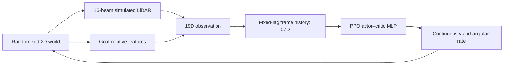

# Mapless Robot Navigation with PPO

**Goal-directed obstacle avoidance from sparse simulated LiDAR, without a pre-built map.**

This project trains a continuous-control navigation policy with [Proximal Policy Optimization (PPO)](https://arxiv.org/abs/1707.06347) in a custom **2D robotics simulator**. The policy chooses forward/backward velocity and angular velocity from a compact 360° LiDAR scan, relative goal information and a short observation history. The repository includes the simulator, a **trained PPO checkpoint**, a Gymnasium interface, evaluation tools and an interactive Pygame visualizer.



> **Evaluation transparency:** The success rates shown above were recorded during development using this policy and are preserved as a historical benchmark. They have **not** yet been rerun end-to-end after the code cleanup. The bundled checkpoint is real and was inspected for integrity and architecture; the provided source was checked against the refactored implementation with deterministic scenarios. No real-world deployment is claimed.

## At a glance

| Area | Implementation |
|:--|:--|
| Learning algorithm | PPO actor–critic with MLP policies (64–64 hidden units for each network) |
| Perception | 16 idealized LiDAR rays over 360° (3 m range), goal distance, sine/cosine of relative goal bearing |
| Observation history | Three 19-dimensional frames at **t−20, t−10 and t**, forming a **57D** vector |
| Continuous control | Signed linear velocity ±0.6 m/s; angular velocity ±1.5 rad/s |
| Environment | Gymnasium, 30 Hz, randomized goals and 1–5 circular static obstacles |
| Reward | Goal progress + terminal rewards − time cost − clearance penalty − quadratic closing-speed risk |
| Reproducibility | Fixed-seed evaluation, episode-level CSV, summary JSON, checkpoint SHA-256 and tests |

## Results

The bundled policy was evaluated historically with **500 seeded episodes per configuration**, using the `hard` scene generator and the default obstacle radius of 0.35 m.

| Obstacles | Successful episodes | Success | Collisions | Timeouts |
|--:|--:|--:|--:|--:|
| 2 | 448 / 500 | **89.6%** | 5 | 47 |
| 3 | 471 / 500 | **94.2%** | 18 | 11 |
| 4 | 461 / 500 | **92.2%** | 30 | 9 |
| 5 | 437 / 500 | **87.4%** | 58 | 5 |

Detailed provenance is in [Experiments](docs/EXPERIMENTS.md), with the raw summary figures in [recorded_benchmarks.csv](results/recorded_benchmarks.csv). These values are descriptive rather than a guarantee of performance: layouts change when the number of obstacles changes.

## Quick start

**Requirements:** Python 3.11+ (Python 3.12 recommended), with PyTorch installed automatically by Stable-Baselines3. The repository is CPU-compatible; a GPU is not required.

```bash
python -m pip install -e ".[test]"
python -m pytest
```

Run the **included trained policy** in the visualizer:

```bash
python run.py view best hard 5
```

Run deterministic evaluation for 2–5 obstacles, saving per-episode and summary files:

```bash
python run.py eval best hard 2-5 --episodes 500 --csv results/evaluation.csv --json results/evaluation.json
```

Visualize a smaller scenario or change obstacle radius:

```bash
python run.py view best hard 3
python run.py eval best hard_passable 5 0.50
```

**Viewer controls:** `N` next episode · `R` replay · `SPACE` pause · `L` LiDAR visibility · `S` screenshot · `ESC` quit.

The packaged policy is located at `models/navigation_ppo.zip`. **Leave it zipped:** the file is a Stable-Baselines3 model checkpoint, not an archive to extract. For a named console script, use `mapless-ppo view best hard 5` after installing the project.

## Training and fine-tuning

```bash
# Train a new policy from scratch
python run.py train scratch mixed 2-5 200000 models/new_policy --lr 0.0003

# Fine-tune the supplied model without overwriting the published checkpoint
python run.py train best mixed 2-5 10000 models/finetuned_policy --lr 0.0001
```

Training writes checkpoints into `models/checkpoints/` and a JSON sidecar for hyperparameters. Existing model paths are not overwritten automatically. PPO trains in rollout batches, so the final number of environment steps may exceed the requested count.

## Architecture



The policy never receives a ground-truth obstacle map: obstacle positions are used by the simulator to synthesize measurements and detect collisions. Three fixed-delay observations help provide motion context without a recurrent network. Reward shaping additionally penalizes **positive closing speed toward nearby obstacles**, addressing a failure mode in which a policy moves into obstacles at excessive speed.

## Repository structure

```text
mapless-ppo-navigation/
├── run.py                     # View / evaluate / train CLI
├── models/
│   └── navigation_ppo.zip     # Bundled PPO model (Stable-Baselines3 format)
├── src/mapless_ppo/
│   ├── navigation.py          # Robot motion, range simulation, reward
│   ├── environment.py         # Gymnasium API and seeded scenes
│   ├── frame_stack.py         # 57D fixed-lag observation history
│   ├── scenarios.py           # Obstacle counts and radius randomization
│   ├── experiments.py         # Training, evaluation and export
│   ├── visualization.py       # Interactive trajectory inspector
│   └── cli.py                 # Argument parsing
├── tests/                     # Environment, geometry and CLI tests
├── results/                   # Recorded benchmark and generated metrics
├── docs/                      # Technical note, experiments, model details
└── assets/                    # Benchmark figure
```

## Reproducibility and limitations

The checkpoint was saved with Stable-Baselines3 2.9.2 and Gymnasium 1.4.0. See the [model card](docs/MODEL_CARD.md) for its hash, architecture, version metadata and verification status. Evaluation defaults to **500 episodes per configuration with seeds 60000–60499**.

This is an **idealized 2D kinematic environment**: circular robot/obstacle geometry, static obstacles, noiseless range sensing, no localization drift, no actuator dynamics, no mapping and no safety-critical controller. The fixed-lag observation buffer does not solve long-horizon partial observability. Physical-robot control and ROS 2 integration are **outside this repository's implemented scope**.

For methodology, trade-offs and reward details, see the [technical brief](docs/PROJECT_BRIEF.md).

---

**Stack:** Python · PyTorch · Stable-Baselines3 · Gymnasium · NumPy · Pygame  
**Author:** Luca Tascone
